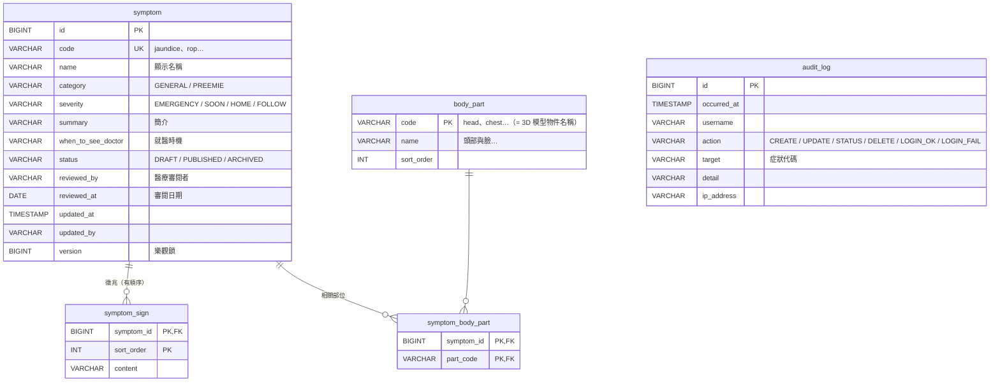

# 寶寶症狀 3D 圖解：後端與管理表單

Spring Boot 3.5 + H2（開發用）+ Flyway。提供 3D 前台讀取的公開 API，以及管理員新增、修改症狀的表單頁面。

## 執行

需要 **JDK 21**（https://adoptium.net 下載 Temurin 21，安裝時勾選「Set JAVA_HOME」與「Add to PATH」，裝完重開 VS Code）。

在 VS Code 終端機（PowerShell），進到這個資料夾：

```powershell
$env:ADMIN_PASSWORD = "自己設一組密碼"
.\mvnw.cmd spring-boot:run
```

第一次會自動下載 Maven 和套件，需要幾分鐘。看到 `Started BabySymptomApplication` 就成功了。

| 網址 | 用途 |
| --- | --- |
| http://localhost:8080/admin/ | 管理表單（帳號 `admin`，密碼是上面設定的） |
| http://localhost:8080/api/symptoms | 公開 API：已發布的症狀 |
| http://localhost:8080/h2-console | 資料庫主控台（需先登入管理頁）。JDBC URL：`jdbc:h2:file:./data/baby-symptom;MODE=PostgreSQL`，帳號 `sa`，密碼空白 |

資料存在 `data/` 資料夾，關掉重開不會消失。想重設成初始資料，關掉程式後刪除 `data/` 即可。

## 資料庫設計



設計重點：

- **部位獨立成表**：`body_part.code` 對應 3D 模型的物件名稱，症狀只能選存在的部位（外鍵保證）。
- **徵兆有順序**：`symptom_sign.sort_order` 讓清單照你排的順序顯示。
- **狀態**：只有 `PUBLISHED` 會出現在前台；草稿可以先存、等醫護審閱後再發布；不想公開時用 `ARCHIVED` 下架，比刪除安全。
- **審閱欄位**：記錄誰、哪天審過內容。發布但沒填審閱者時，表單會提醒。
- **樂觀鎖 `version`**：兩個人同時編輯同一筆時，後存的人會被擋下並提示重新載入，不會互相覆蓋。
- **稽核紀錄**：每次新增、修改、改狀態、刪除、登入成功與失敗都會記錄，只新增不修改。
- **資料表由 Flyway 管理**：`db/migration/V1__schema.sql` 建表、`V2__seed.sql` 放初始資料。之後要改結構請新增 `V3__xxx.sql`，不要改已經執行過的檔案。

## API

| 方法 | 路徑 | 權限 | 用途 |
| --- | --- | --- | --- |
| GET | `/api/parts` | 公開 | 部位清單 |
| GET | `/api/symptoms` | 公開 | 已發布的症狀（格式和前端 `symptoms.js` 相同） |
| GET | `/api/admin/symptoms` | 管理員 | 全部症狀（含草稿、下架） |
| GET | `/api/admin/symptoms/{id}` | 管理員 | 單筆 |
| POST | `/api/admin/symptoms` | 管理員 | 新增 |
| PUT | `/api/admin/symptoms/{id}` | 管理員 | 修改（需帶 `version`） |
| PATCH | `/api/admin/symptoms/{id}/status` | 管理員 | 只改狀態 |
| DELETE | `/api/admin/symptoms/{id}` | 管理員 | 刪除 |
| GET | `/api/admin/audit-logs` | 管理員 | 最近 100 筆稽核紀錄 |

## 資安設計（藍隊重點）

- 管理功能需登入，密碼用 BCrypt 雜湊；密碼從環境變數讀，不寫在程式碼裡
- 修改類請求都要 CSRF token
- 預設拒絕：沒列在規則裡的網址一律 403
- 伺服器端欄位驗證（長度、格式、必填、部位必須存在）
- 前端一律用 `textContent` 顯示資料，加上 CSP 標頭，防止儲存型 XSS
- CORS 只開放 3D 前台讀取公開 API
- 錯誤訊息不回傳系統內部細節
- 登入失敗會寫入稽核紀錄與伺服器日誌

可以再加的：登入失敗次數限制、多個管理員帳號存資料庫、日誌送到 ELK / Wazuh 做告警。

## 改用 PostgreSQL

1. `pom.xml` 取消註解 `postgresql` 和 `flyway-database-postgresql`
2. `application.properties` 改用下方註解的 PostgreSQL 設定，並設定 `DB_USER`、`DB_PASSWORD` 環境變數

SQL 寫法已相容 PostgreSQL，Flyway 會自動建表。
